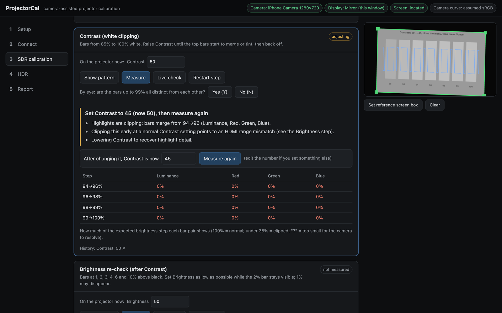
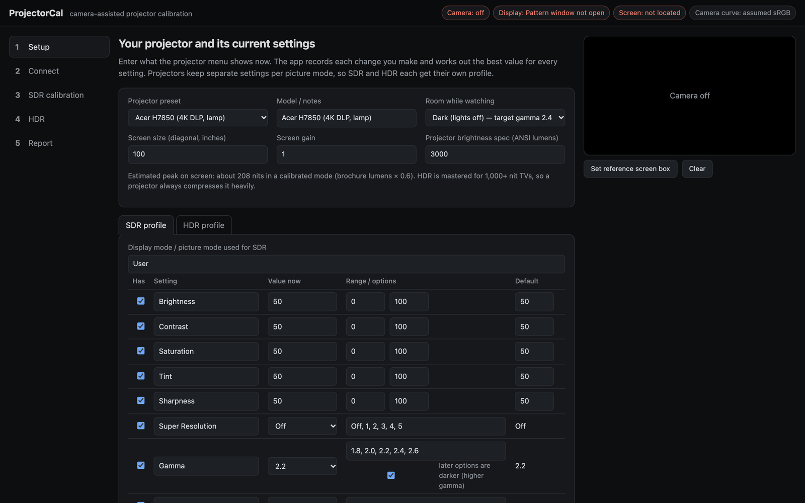
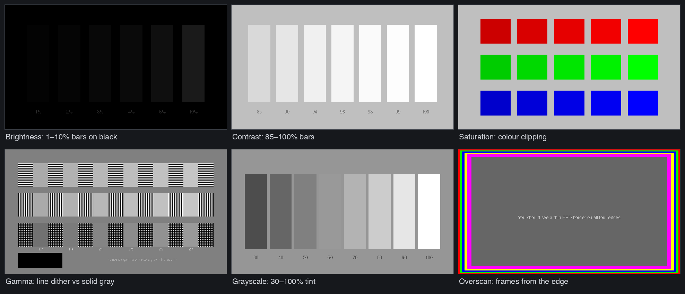
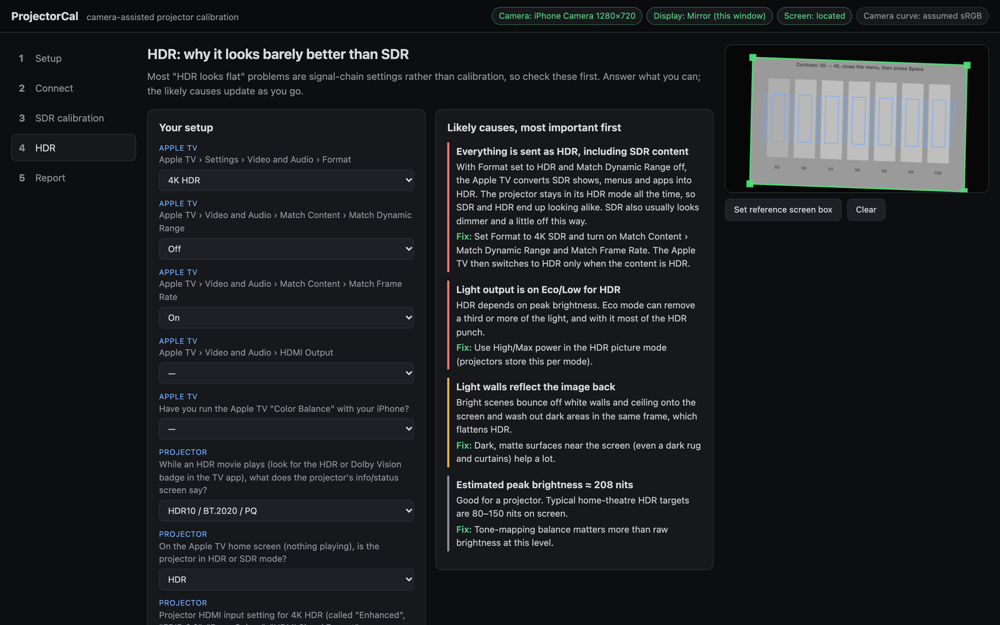

# ProjectorCal

**Calibrate a home-theatre projector with the camera you already own.**

ProjectorCal puts test patterns on your projector, photographs them with a webcam or an iPhone, and tells you which menu setting to change and to what: *"Set Contrast to 45 (now 50), then measure again."* It repeats each test until that setting settles on the best value. It also walks through the settings that usually make **HDR look barely better than SDR**, and generates HDR10 test videos to check them.

Everything runs locally in your browser. No images, measurements or settings leave your machine.



## Contents

- [Why a camera?](#why-a-camera)
- [Quick start](#quick-start)
- [A calibration session](#a-calibration-session)
- [What it measures](#what-it-measures)
- [HDR](#hdr)
- [How it stays honest with a consumer camera](#how-it-stays-honest-with-a-consumer-camera)
- [Projector presets](#projector-presets)
- [Privacy](#privacy)
- [Development](#development)

## Why a camera?

Proper calibration uses a colorimeter, which costs a few hundred dollars and needs software that speaks to it. A phone or laptop camera is not a meter: it auto-exposes, auto-white-balances and applies its own tone curve, so its absolute numbers mean little.

It can, however, reliably answer two kinds of question: *are these two patches different?* and *are these two patches the same?* Those questions are enough to set Brightness, Contrast, Saturation and Gamma, find overscan, and catch a gray scale that drifts warm or cool. Every test in ProjectorCal is designed around them. When the camera can't tell, the app says so and lets you answer by eye instead of guessing.

## Quick start

You need a camera (an iPhone via Continuity Camera is best; any webcam works), **Chrome or Safari**, and either Docker or Python 3.

```bash
git clone https://github.com/ben16stuart/ProjectorCalibration.git
cd ProjectorCalibration
docker compose up -d --build
```

Then open **http://localhost:7904**. Use `PORT=8080 docker compose up -d --build` to change the port.

**Without Docker:** ProjectorCal is a static site with no build step and no dependencies, so any web server will do:

```bash
python3 -m http.server 7904 --bind 127.0.0.1 --directory web
```

Browsers only allow camera access on `localhost` or HTTPS, so opening `web/index.html` directly as a file won't work.

## A calibration session

The app walks you through five pages:

| Page | What you do |
|---|---|
| **1 Setup** | Pick a projector preset and type in what the projector menu shows now. SDR and HDR picture modes each get their own profile. |
| **2 Connect** | Get the patterns onto the projector, start the camera, and let the app find the screen in the camera view. |
| **3 SDR calibration** | Run the tests in order. After each one, change the setting it suggests, enter the new value, and measure again until it says the setting is done. |
| **4 HDR** | Answer the signal-chain checklist, then play the HDR test videos. |
| **5 Report** | Before → after for every setting, plus Copy as text and Export/Import JSON. |



**Before you start:**
- Use the picture mode you actually watch in.
- Turn off dynamic contrast, dynamic iris and "enhancement" features (on the Acer: Dynamic Black and AcuEngine). They change the picture between patterns, which defeats the comparisons. Turn them back on later if you like the look.
- Make the room dark, as it is when you watch, and let a lamp projector warm up for 15 minutes.
- Close the projector menu before each measurement.

### Getting patterns onto the projector

| Mode | How | Best for |
|---|---|---|
| **Extended display** (default) | Use the projector as a second display: on a Mac, Control Center › Screen Mirroring › Apple TV › *Use As Separate Display*, or an HDMI cable. Open the pattern window from the Connect page, move it to the projector and click it to go full screen. Chrome can place the window on the projector for you; in Safari, drag it there. | Working from your seat with the laptop in front of you |
| **Mirroring** | The pattern fills the app window itself, with instructions drawn on the pattern so you can work from the couch with the keyboard. | A single screen, or the MacBook camera |
| **Videos on the streaming box** | Play the generated test videos on the Apple TV (or any player) and use *Locate from video flashes*. | The most faithful SDR path, and **the only way to test HDR**: a Mac cannot send HDR over AirPlay |

Set the projector display's resolution to match what the projector receives, so nothing is rescaled on the way.

### The camera

- **An iPhone as a Continuity Camera** is much better in a dark room than a laptop camera. Put it on a tripod or prop it near your seat, landscape, locked, with the rear camera facing the screen.
- If **Chrome** doesn't list the iPhone, use **Safari**, which does. Settings are stored per browser; use Export/Import JSON on the Report page to move them.
- With the camera running, open Control Center › Video Effects and turn off **Center Stage, Portrait, Studio Light and Reactions**. They crop and alter the picture.
- Frame the whole projected image so it fills most of the view. Don't move the camera after *Locate screen*, or locate again.
- If the iPhone is unlocked, picked up or gets a call, Continuity Camera pauses. The app then stops the measurement and tells you; it never measures a frozen picture.

### Keyboard shortcuts

On the SDR and HDR pages, or while a pattern is full screen:

| Key | Action |
|---|---|
| Space / Enter | Measure |
| Y / N | Answer the test's "by eye" question yourself |
| P | Show the pattern without measuring |
| Esc | Take the pattern down (mirroring mode) |
| F | Full screen (in the pattern window) |

## What it measures



| Step | Pattern | What the camera decides | Reliability with a consumer camera |
|---|---|---|---|
| Overscan | Coloured frames 0–6% in from the edge | How much of the picture is cut off at each edge | Good |
| Brightness | 1–10% bars on black | The lowest Brightness that keeps the 2% bar visible | Good with an iPhone; a laptop camera may be too noisy in a dark room (then judge by eye) |
| Contrast | 85–100% bars | The highest Contrast before white, or one colour, clips | Good |
| Brightness re-check | 1–10% bars | Re-checks black after Contrast moved it | As Brightness |
| Saturation | 80–100% red, green and blue bars | Colour clipping | Good |
| Gamma | Fine line pattern next to solid grays | Gamma at 25% and 50% light, compared with your room's target (2.4 dark, 2.3 dim, 2.2 bright) | Good, as long as the picture isn't rescaled |
| Grayscale | 30–100% grays | Whether dark and bright grays tint differently (RGB Bias); with a reference screen in view, the overall white (RGB Gain) | Directional only: camera colour isn't human colour |
| HDR black | PQ code 72–120 bars | Brightness in the HDR picture mode | As Brightness |
| HDR highlights | 100 to 10,000-nit patches | Where tone mapping clips, and how bright ordinary "paper white" ends up | Ratios are approximate; run Gamma first so the app can calibrate the camera |

For Brightness and Contrast the app doesn't guess how far to move a setting. It searches: it steps in one direction, doubling the step while the answer stays the same, and then bisects once the answer flips. After a few rounds it has pinned the setting to a single click.

**Not measured:** absolute colour temperature in kelvin, colour gamut, and absolute brightness in nits. Those need a real meter.

## HDR

Most "HDR looks flat" problems are signal-chain settings rather than calibration. The HDR page asks about your setup and ranks the likely causes. The classic one: the Apple TV is set to **4K HDR** with **Match Dynamic Range** off, so everything, menus and SDR shows included, is sent as HDR and SDR and HDR end up looking alike.



### Test videos

The HDR tests, and the most faithful SDR route, use test videos played on the streaming box:

```bash
python3 tools/make_videos.py --verify    # about 3 minutes, writes videos/*.mp4 (~90 MB)
```

This needs `ffmpeg` with libx264 and libx265, Python 3 with `numpy` and `Pillow`, and Node.js (pattern definitions are read from `web/js/patterns.js`). `--verify` decodes every file and checks that each gray patch carries exactly the intended code value.

| Files | Format |
|---|---|
| `black`, `white`, `gamma`, `grayscale`, `colorclip`, `overscan` | SDR: H.264, BT.709, limited range |
| `hdr_black`, `hdr_hl1000`, `hdr_hl4000` | HDR10: HEVC Main10, BT.2020/PQ, mastering and MaxCLL metadata (1,000 or 4,000 nits), tagged `hvc1` for Apple devices |

Each video starts with black/white flashes that the app uses to find the screen, then holds its pattern for 3 minutes. To play them on an Apple TV: AirPlay them from an iPhone's Photos app, put them in iCloud Photos and open the Apple TV Photos app, or use a player such as Infuse or Plex. While an HDR file plays, check the projector's info screen says HDR. A media server that transcodes instead of playing the file directly (Plex: the dashboard shows Transcode rather than Direct Play) converts HDR to SDR, and the HDR tests then measure that conversion instead of your projector.

## How it stays honest with a consumer camera

- **Only compare within one frame.** Auto-exposure and auto white balance scale the whole picture, so they cancel when one patch is compared with another in the same frame. Absolute camera values are never compared between patterns.
- **Compare each bar with the background right beside it.** That cancels screen hot-spotting and lens vignetting.
- **Ask "equal?" rather than "how much?"** The gamma test puts a fine black/white line pattern, which averages optically to exactly 50% light, next to solid grays. Whichever gray matches it gives the gamma, whatever the camera's own curve is. Each gray sits between two line patches so brightness gradients cancel too.
- **Calibrate the camera from the screen.** Comparing the 50% line pattern with a 25% dot pattern measures the camera's own response curve, which the HDR and grayscale readings then use.
- **Say when it can't tell.** If the camera crushes blacks, saturates, or resolves the individual lines, the result is marked inconclusive and you answer by eye.
- **Wait for the picture to settle.** Each measurement waits until the camera image stops changing, which absorbs AirPlay latency and auto-exposure, and then averages many frames.

## Projector presets

| Preset | Notes |
|---|---|
| **Acer H7850** | Uses this projector's menu names: Display Mode, Wall Color, Brightness, Contrast, Saturation, Tint, Color Temperature, Gamma, Sharpness, Super Resolution, RGB Gain/Bias, AcuEngine, Dynamic Black, HDR. |
| **Generic** | Common names and ranges for any projector or TV. |

On the Setup page you can rename any control, change its range or options, and untick controls your projector doesn't have. Suggestions come out in your projector's units, so **check the ranges against your menu**. To add a built-in preset, add an entry to `PRESETS` in [`web/js/advisor.js`](web/js/advisor.js).

## Privacy

- Camera frames are analysed in the browser and never stored or uploaded.
- Settings and results live in the browser's `localStorage`. Export them as JSON to keep a copy.
- The server, whether nginx in Docker or any static server, only serves files. The Docker setup listens on `127.0.0.1` only.

## Development

```
web/                 the app (static: HTML, CSS, ES modules)
  js/patterns.js     every test pattern, the single source for the browser, analyzers and videos
  js/analysis.js     camera statistics → measurements and verdicts (pure functions)
  js/advisor.js      presets, guided searches and advice text
  js/geometry.js     screen detection and homography
  js/camera.js       camera access, pause/freeze detection
  js/hdr.js          HDR checklist and diagnosis rules
tests/               node:test suites and a projector + camera simulator
tools/               HDR/SDR test-video generator
```

```bash
npm test    # Node 18+, no dependencies
```

`tests/sim.mjs` renders patterns through a projector model with known errors (brightness offset, contrast clipping, gamma, RGB bias, overscan, an HDR tone curve). It then photographs them with a simulated camera that has perspective, blur, vignetting, centre-weighted auto-exposure, auto white balance, an sRGB curve and noise. The tests check that the analysis recovers the true values and that the guided searches converge. Any change to an analyzer or pattern should keep these passing.
